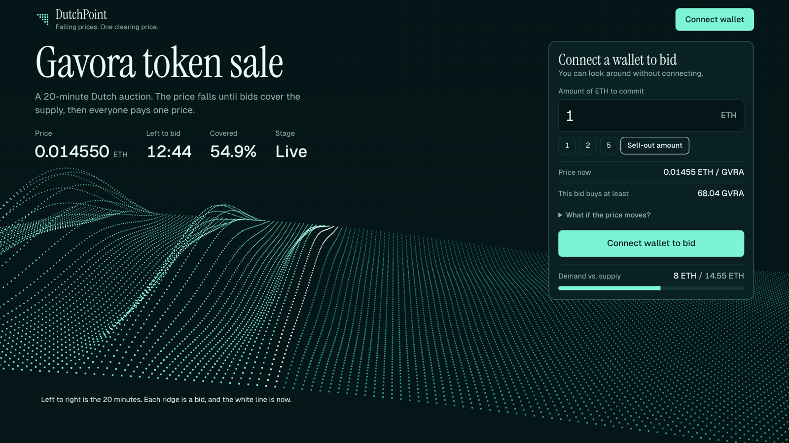
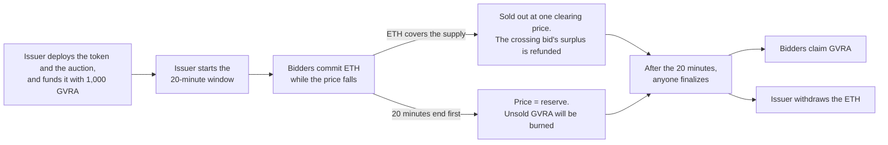

# DutchPoint

[](https://github.com/JacksonSeowJX/Blockchain-DutchPoint/actions/workflows/ci.yml)
[](https://github.com/JacksonSeowJX/Blockchain-DutchPoint/actions/workflows/pages.yml)

**DutchPoint: A Decentralized Dutch Auction Platform** - *Falling prices. One clearing price.*

DutchPoint sells the **Gavora (GVRA)** ERC20 token in a 20-minute Dutch auction on Ethereum. Connect a
wallet, watch the price fall, and bid for GVRA with ETH. When the auction ends, every winner pays the same
price.

SC4053 Blockchain Technology, AY2026-27 Semester 1 - Development Project, Option 2. Group **DutchPoint**.



| I want to... | Go to |
| --- | --- |
| See it running now, no setup | **Live site:** <https://jacksonseowjx.github.io/Blockchain-DutchPoint/> (Sepolia testnet; the latest auction has finished, so it shows the result) |
| Run it and bid myself | [Quick start](#quick-start-run-it-on-your-machine): a local chain, about 5 minutes, no API keys or test ETH |
| See every rule work in one command | [`npm run demo`](#see-it-work-without-a-wallet), no wallet or browser needed |
| Watch the demo | `DutchPoint.mp4`, the demo video submitted with this code (under 10 minutes) |
| Read the AI Audit Report | [`docs/ai-audit/report.md`](docs/ai-audit/report.md) |
| Check the contracts on-chain | [GavoraToken](https://sepolia.etherscan.io/address/0x2f3C5e8B944fE3E67d40cDF9a68d3B1512D02Fbf#code) and [DutchAuction](https://sepolia.etherscan.io/address/0xAB0f2B36150eC6D8C9f096CFA592eEDF82A8A8a8#code) on Sepolia Etherscan |

## Contents

1. [How the auction works](#how-the-auction-works)
2. [Quick start: run it on your machine](#quick-start-run-it-on-your-machine)
3. [Run an auction from start to finish](#run-an-auction-from-start-to-finish)
4. [Troubleshooting](#troubleshooting)
5. [See it work without a wallet](#see-it-work-without-a-wallet)
6. [Testing and security](#testing-and-security)
7. [On the Sepolia testnet](#on-the-sepolia-testnet)
8. [How the contracts work](#how-the-contracts-work)
9. [Project structure](#project-structure)
10. [All commands](#all-commands)
11. [Documentation](#documentation)
12. [Team](#team)

## How the auction works

- The issuer puts **1,000 GVRA** up for sale. The price falls in a straight line from a high start price
  to a reserve price over exactly **20 minutes**.
- Bidders commit ETH whenever the price looks fair. As the price keeps falling, the same ETH buys more
  GVRA, so there is no rush to bid first.
- The moment the committed ETH can buy the whole supply, the auction **sells out**. The bid that crosses
  the line buys only what is left, and its surplus ETH is refunded in the same transaction.
- Every winner pays the **same clearing price**, however early they bid.
- If the 20 minutes end first, everyone pays the reserve price and the unsold GVRA is **burned**.



**A real example** (Sepolia, 6 Nov 2026): three bids of 0.01, 0.025 and 0.03 ETH. The third bid sold the
auction out 10 min 36 s in, at 0.0000576 ETH per GVRA: 0.0226 ETH of it was accepted and 0.0074 ETH
refunded in the same transaction. Every bidder then paid 0.0000576, including the first, who had bid at
0.000092, and the issuer received 1,000 × 0.0000576 = 0.0576 ETH.
[All three Sepolia runs](#three-auctions-run-on-sepolia) are listed below with their transactions.

## Quick start: run it on your machine

Everything runs locally: a Hardhat chain, the two contracts and the React dashboard. You don't need
testnet ETH, API keys or a `.env` file.

**You need**

| | |
| --- | --- |
| **Node.js 22.13.0 or later**, with npm | Hardhat 3 refuses to start on older versions (CI uses Node 24). Check with `node --version` |
| **MetaMask** in a desktop browser | Or another browser wallet |
| **macOS, Linux or WSL** | The npm scripts use POSIX shell syntax, so on Windows run them inside WSL |
| Ports **8545** and **5173** free | For the local chain and the dashboard |
| Internet for the first install | npm packages, and the Solidity 0.8.28 compiler Hardhat downloads on first use |

### Step 1. Get the code and install

```bash
git clone https://github.com/JacksonSeowJX/Blockchain-DutchPoint.git
cd Blockchain-DutchPoint
npm ci
```

Or unzip the submitted `DutchPoint.zip`, `cd` into the folder that contains `package.json`, and run
`npm ci`. One install covers the contracts, tests, scripts and dashboard, and every command in this README
runs from this folder.

### Step 2. Start the chain, deploy and open the dashboard

Open two terminals in the project folder.

```bash
# Terminal 1: the local chain (mines a block every 2 s). Leave it running.
npm run node
```

```bash
# Terminal 2: deploy the token and the auction, start the 20 minutes, then serve the dashboard
npm run deploy:local
npm run dev
```

Open <http://127.0.0.1:5173>. The dashboard shows the auction even before you connect a wallet.

Good to know:

- `npm run node` prints 20 test accounts with 10,000 ETH each, and their private keys. Account #0 deploys
  the contracts and is the **issuer**.
- The 20 minutes start as soon as `deploy:local` finishes. For a fresh auction at any time, run
  `npm run deploy:local` again and reload the page.
- The default sale is 1,000 GVRA, with the price falling from 0.02 to 0.005 ETH per GVRA. Change it with
  `SALE_SUPPLY`, `START_PRICE` or `RESERVE_PRICE`, for example `START_PRICE=0.05 npm run deploy:local`.
  `START_AUCTION=false` deploys without starting, so the issuer starts the window from the dashboard.
- Optional: `npm run seed:local` places three bids from accounts #1-#3 (Alice, Bob and Carol), so the
  dashboard has some history. It also moves the chain clock forward 7 minutes.

### Step 3. Connect MetaMask

1. **Add the network.** Click *Connect wallet*. If MetaMask is on another network, a banner offers
   *Switch to Hardhat Local*: click it and approve. To add the network by hand, use RPC URL
   `http://127.0.0.1:8545`, chain ID `31337` and currency symbol `ETH`.
2. **Import a test account.** In MetaMask choose *Import account* and paste a private key printed by
   `npm run node`. Bid from account #4 or later (#0 is the issuer, #1-#3 are used by `seed:local`).
   Import #0 as well to try the issuer's actions. These keys are public: never use them on a real network.
3. **After restarting the node**, the chain starts empty. Run `npm run deploy:local` again, and in
   MetaMask use *Settings → Advanced → Clear activity tab data* so the account nonces reset.

## Run an auction from start to finish

1. **Look around.** At the top are the falling price, the time left and the bid panel, over a surface of
   points: left to right is the 20 minutes, each ridge is a bid, and the white line is now. Below are tabs
   for the bids, the price chart, your bid, the sale details and how the auction works.
2. **Bid.** Enter an ETH amount (or click a quick amount) and click *Bid … ETH*. *This bid buys at least*
   shows the minimum the bid is sent with: what it buys at today's price, less 1%. The contract enforces
   it: if the auction fills up before the bid is mined and it would buy less, the bid is cancelled and no
   ETH is committed. The final price can only be at or below today's, so you usually get more.
3. **Sell it out.** Click *Sell-out amount* (the ETH that buys everything left, rounded up) and add a
   little more if you like. The panel shows how much will come straight back. A sell-out bid is sent
   without a minimum: it buys whatever is left when it is mined. Once it is mined, the stage changes to
   *Sold out*, and the *Bids* tab shows the surplus that was returned.
4. **Skip the wait.** In the *Sale details* tab, the *Local demo tools* card moves the chain clock forward.
   Click **+20 min**. The stage becomes *Ready to finalize*.
5. **Finalize and claim.** Click *Finalize auction*, then *Claim …*. The GVRA arrives in your wallet, and
   *Add GVRA to your wallet* lists the token in MetaMask.
6. **Collect the proceeds.** Switch MetaMask to account #0 (the issuer) and click *Withdraw … proceeds*
   under *Settlement* in the *Sale details* tab.

The *Local demo tools* card appears only on the local chain. From the command line,
`ADVANCE_SECONDS=600 npm run time:advance` does the same (300 seconds by default).

The page has a single dark design. Browsers without WebGL, and visitors who ask for reduced motion, get
the same page without the moving surface.

## Troubleshooting

| Symptom | Fix |
| --- | --- |
| "Can't reach the local Hardhat node at 127.0.0.1:8545" | Start `npm run node` and keep that terminal open |
| "No auction on the local chain yet" or "No DutchPoint auction is deployed on the local node" | Run `npm run deploy:local` (again after every node restart), then reload the page |
| MetaMask transactions fail with nonce errors after a node restart | *Settings → Advanced → Clear activity tab data* |
| MetaMask still uses Sepolia on this page after you switched it to Hardhat Local | MetaMask remembers a network for each site. Use the page's *Switch to Hardhat Local* banner, or pick the network in MetaMask's menu for this site |
| Port 5173 is already in use | Vite picks the next free port and prints the URL |
| "You are using Node.js … which is not supported by Hardhat" | Install Node.js 22.13.0 or later |

## See it work without a wallet

```bash
npm run demo
```

This runs five scenarios on an in-process chain and prints the results. It needs no node, wallet or
browser:

1. a sale that sells out early, with the crossing bid's surplus refunded automatically;
2. an undersubscribed sale settling at the reserve price, with the unsold GVRA burned;
3. a contract bidder that rejects ETH, which keeps its refund as a credit it can withdraw;
4. a reentrancy attack draining a deliberately vulnerable auction;
5. the same attack failing against DutchPoint.

## Testing and security

| Command | What it runs |
| --- | --- |
| `npm test` | All 63 contract tests: 53 Mocha tests, 5 Solidity fuzz tests (1,000 runs each) and 5 invariants (256 runs, depth 50) |
| `npm run test:frontend` | 32 dashboard unit tests (Vitest and React Testing Library) |
| `npm run coverage` | All contract tests with coverage: `DutchAuction.sol` and `GavoraToken.sol` are at 100% of lines and statements |
| `npm run gas` | Gas use per function, and a check that each call costs the same with 1 or 100 earlier bidders |
| `npm run slither` | Slither static analysis; fails on any Medium or High finding |
| `npm run check` | `compile`, `test`, `test:frontend`, `typecheck` and `build` in one go |

CI (`.github/workflows/ci.yml`) runs `compile`, `coverage`, `typecheck`, `build`, `demo` and `slither` on
every push to `main` and every pull request.

Slither needs Python. Install it the way CI does (Python 3.12), then select the compiler:

```bash
pip install slither-analyzer==0.11.6 solc-select
# or: uv tool install --python 3.12 slither-analyzer==0.11.6 && uv tool install solc-select
solc-select install 0.8.28 && solc-select use 0.8.28
```

The security design (no loops over bidders, checks-effects-interactions behind `ReentrancyGuard`, refunds
that fall back to a withdrawable credit) is under [How the contracts work](#how-the-contracts-work). The
[AI Audit Report](docs/ai-audit/report.md) covers the bugs found in the AI-generated code, how each was
found and the test that proves the fix.

## On the Sepolia testnet

You don't need this to test or grade the project; the local quick start covers everything. The public
deployment shows the dApp working on a real network, with every transaction on Etherscan.

### The live site

**<https://jacksonseowjx.github.io/Blockchain-DutchPoint/>** reads the current Sepolia auction:
[GavoraToken](https://sepolia.etherscan.io/address/0x2f3C5e8B944fE3E67d40cDF9a68d3B1512D02Fbf#code) and
[DutchAuction](https://sepolia.etherscan.io/address/0xAB0f2B36150eC6D8C9f096CFA592eEDF82A8A8a8#code)
(addresses in [`deployments/sepolia.json`](deployments/sepolia.json)). That auction ran on 6 Nov 2026 and
has finished, so the site shows its result and bid history; to place bids yourself, use the
[quick start](#quick-start-run-it-on-your-machine). Viewing needs no wallet. With MetaMask on Sepolia, the
site also shows your own bid.

### Three auctions run on Sepolia

All three were run through the website with MetaMask: 1,000 GVRA each, with the price falling from 0.0001
to 0.00002 ETH per GVRA over 20 minutes.

| Date | Auction | Bids (ETH) | What happened | Price everyone paid (ETH/GVRA) |
| --- | --- | --- | --- | --- |
| 6 Nov 2026 | [`0xAB0f…A8a8`](https://sepolia.etherscan.io/address/0xAB0f2B36150eC6D8C9f096CFA592eEDF82A8A8a8) | 0.01, 0.025, 0.03 | Sold out 10 min 36 s in; [0.0074 ETH refunded](https://sepolia.etherscan.io/tx/0x809c0ce34d492624783b6b832aec317bcce187fe6c685563393da04f621b657a) in the crossing bid's transaction; claims of 173.61, 434.03 and 392.36 GVRA | 0.0000576 |
| 3 Nov 2026 | [`0x713e…b1Eb`](https://sepolia.etherscan.io/address/0x713e80Bea173f595b191ce635fa7dB45395cB1Eb) | 0.01, 0.015, 0.018 | Sold out 15 min in; [0.003 ETH refunded](https://sepolia.etherscan.io/tx/0x2fe8ff425b7f2100b7ebb941bf03b43f68f58c2bfdf26939b275215fd37906f2) in the crossing bid's transaction; claims of 250, 375 and 375 GVRA | 0.00004 |
| 23 Oct 2026 | [`0xe0f2…6FC0`](https://sepolia.etherscan.io/address/0xe0f23743C959A9b9774114838A5fbD20d75C6FC0) | 0.01, 0.005 | Undersubscribed: the window ran out, 750 GVRA were claimed and [250 GVRA burned](https://sepolia.etherscan.io/tx/0x6f6f2b258ee65412ce38361d1ba3ecf076a4b67c656ad4f31021fc5c41c211c4) | 0.00002 (the reserve) |

The 23 Oct auction ran the contract before bid protection (the on-chain minimum) was added. Each run's
deployment is recorded in [`deployments/`](deployments/), and the AI Audit Report (section 6) lists every
transaction.

### Deploy your own

```bash
npm run keystore -- set SEPOLIA_RPC_URL        # e.g. an Alchemy, Infura or PublicNode Sepolia URL
npm run keystore -- set SEPOLIA_PRIVATE_KEY    # a throwaway wallet holding Sepolia test ETH
npm run keystore -- set ETHERSCAN_API_KEY      # only for source verification
START_PRICE=0.0001 RESERVE_PRICE=0.00002 npm run deploy:sepolia
```

The keystore is encrypted with a password you choose; you can also export the same names as environment
variables instead. Set `START_PRICE` and `RESERVE_PRICE`: the defaults (0.02 and 0.005 ETH) are meant for
the local chain, where a sell-out costs 5 to 20 ETH. Add `START_AUCTION=false` to start the
window later from the site.

The script prints Etherscan links and the exact `npm run verify:sepolia -- …` commands for both contracts.
It records the deployment in `deployments/sepolia.json` and writes the addresses to
`frontend/src/generated/deployments.json`; commit both and push to `main`, and the live site switches to
the new auction a few minutes later. To point a dashboard on your machine at Sepolia instead, copy
`.env.example` to `.env` and set `VITE_DEFAULT_CHAIN_ID=11155111`.

### How the live site is built

- `.github/workflows/pages.yml` builds the dashboard and publishes it to GitHub Pages on every push to
  `main`. The build defaults to Sepolia and is served from the `/Blockchain-DutchPoint/` path.
- It reads the chain through the `VITE_READ_RPC_URL` repository variable, or the keyless PublicNode
  Sepolia RPC if that is not set (*Settings → Secrets and variables → Actions → Variables*). Everything in
  the build is public JavaScript, so this must never be a secret URL.
- PublicNode keeps only about two days of event logs, so older bid history comes from Blockscout's keyless
  logs API (audit findings D1 and D2). The site asks it at most once per page load and keeps settled bids
  in the browser.
- A fork of this repository needs one setting before its Pages workflow works: *Settings → Pages → Source:
  GitHub Actions*. GitHub's free plans only offer Pages for public repositories.

To preview the hosted build locally:

```bash
VITE_DEFAULT_CHAIN_ID=11155111 npm run build -- --base /Blockchain-DutchPoint/
npx vite preview frontend --base /Blockchain-DutchPoint/ --port 4173   # http://127.0.0.1:4173/Blockchain-DutchPoint/
```

## How the contracts work

- **`GavoraToken`** (ERC20 "Gavora", GVRA) mints its whole supply once to the deployer, who transfers the
  sale supply into the auction. There is no mint function and no owner, so the supply can only go down
  (by burning).
- **`DutchAuction`** runs the sale:

| Function | Who | What it does |
| --- | --- | --- |
| `start()` | Issuer | Opens the 20-minute window |
| `contributeWithMinimum(minTokens)` | Bidder | Places a bid that reverts unless it buys at least `minTokens` GVRA; the dashboard uses it for every bid except a sell-out |
| `contribute()`, or a plain ETH transfer | Bidder | Places a bid with no minimum |
| `finalize()` | Anyone, after the window | Fixes the final price and burns unsold GVRA |
| `claimTokens()` | Bidder | Pays out `commitment / finalPrice` GVRA |
| `withdrawIssuerProceeds(recipient)` | Issuer | Withdraws the sale's ETH to the given address |
| `withdrawRefundTo(recipient)` | Bidder | Collects a refund that the bidder's own contract rejected, to any address |
| `burnRemainderAfterAllClaimed()` | Anyone | Burns rounding dust left after every claim |

- There are no loops over bidders, so every call costs the same however many people bid.
- Refunds follow checks-effects-interactions behind `ReentrancyGuard`. If a bidder's contract rejects a
  refund, the ETH is kept as a credit it can withdraw, instead of blocking the auction.
- The maths, including the exact clearing price when time alone clears the auction, is in
  [`docs/design/spec.md`](docs/design/spec.md). The full architecture is in
  [`docs/design/architecture.md`](docs/design/architecture.md).

## Project structure

```text
contracts/                   On-chain code
  GavoraToken.sol            ERC20 "Gavora" (GVRA): fixed supply, burnable, no owner, no mint
  DutchAuction.sol           The auction
  mocks/                     Test-only: ReentrancyAttacker, RejectingReceiver,
                             VulnerableAuction (deliberately vulnerable)
test/
  DutchAuction.test.ts       Scenario and unit tests
  AuditRegressions.test.ts   Regression tests for audit findings F1-F4
  BidProtection.test.ts      Bids with an on-chain minimum (contributeWithMinimum)
  Reentrancy.test.ts         Vulnerable vs. secure reentrancy demonstration
  GavoraToken.test.ts        Token tests
  Gas.test.ts                Gas-scaling test (cost independent of the number of bidders)
  solidity/                  Fuzz and invariant tests (forge-std)
scripts/                     deploy, demo, seed-local, advance-time, poc-crowd-out, export-frontend
frontend/                    Off-chain code: the React + Vite dashboard
  src/                       components/, hooks/, lib/, generated/ (ABIs and addresses),
                             *.test.ts(x) beside the code they test, test/ (fixtures, fake chain)
docs/
  ai-audit/                  AI Audit Report, development log, evidence/, prompts/
  design/                    Spec, architecture, assumptions, requirements checklist
  demo/                      Demo script, screenshots/
deployments/                 Sepolia deployment records
.github/workflows/           ci.yml (tests, build, Slither) and pages.yml (GitHub Pages)
hardhat.config.ts            Solidity 0.8.28, networks (local node, Sepolia), fuzz/invariant settings
slither.config.json          Slither remappings and filters
.env.example                 Optional dashboard settings; Sepolia secrets go in the keystore
```

Generated and gitignored: `artifacts/`, `cache/`, `coverage/`, `frontend/dist/`,
`frontend/src/generated/deployments.local.json` and `.hardhat-home/` (every Hardhat script runs with
`HOME` set to it, so the Sepolia keystore lives there).

## All commands

Every script in `package.json`, run from the project folder.

| Command | What it does |
| --- | --- |
| **Local app** | |
| `npm run node` | Local Hardhat chain on `127.0.0.1:8545`, mining a block every 2 s |
| `npm run deploy:local` | Deploy and start the auction locally; write ABIs and addresses for the dashboard |
| `npm run seed:local` | Three sample bids from test accounts #1-#3 |
| `npm run time:advance` | Move the local chain clock forward `ADVANCE_SECONDS` (default 300) |
| `npm run dev` | Dashboard on `http://127.0.0.1:5173` |
| **Build** | |
| `npm run compile` | Compile the contracts (Solidity 0.8.28) |
| `npm run typecheck` | Type-check the dashboard, `hardhat.config.ts`, `scripts/` and `test/` |
| `npm run build` | Type-check and build the dashboard into `frontend/dist/` |
| `npm run export:frontend` | Compile and copy the ABIs into `frontend/src/generated/` without deploying |
| `npm run check` | `compile`, `test`, `test:frontend`, `typecheck` and `build` in sequence |
| **Tests and analysis** | |
| `npm test` | All 63 contract tests (Mocha, fuzz and invariants) |
| `npm run test:mocha` | The 53 Mocha tests |
| `npm run test:solidity` | The 5 fuzz tests and 5 invariants |
| `npm run test:frontend` | The 32 dashboard unit tests (Vitest) |
| `npm run coverage` | All contract tests with a coverage report (`coverage/`) |
| `npm run gas` | Mocha tests with the gas-scaling table and per-function gas statistics |
| `npm run slither` | Slither on both contracts (needs `slither-analyzer` and `solc` 0.8.28) |
| `npm run demo` | The five scenarios, printed |
| **Sepolia (optional)** | |
| `npm run keystore -- set <NAME>` | Store a secret in the encrypted Hardhat keystore |
| `npm run deploy:sepolia` | Deploy, fund and (unless `START_AUCTION=false`) start the auction on Sepolia |
| `npm run verify:sepolia -- <address> <constructor args>` | Verify a contract's source on Etherscan, Blockscout and Sourcify (the deploy script prints the exact commands) |
| **Submission** | |
| `npm run package` | Build `DutchPoint.zip` from the last commit, with the full git history (cited as evidence in the AI Audit Report) and without `node_modules` or build output. Refuses to run with uncommitted changes |

## Documentation

| Document | Contents |
| --- | --- |
| [`docs/ai-audit/report.md`](docs/ai-audit/report.md) | **AI Audit Report**: 8 sections, every finding with its evidence, and an appendix linking the design to the lectures |
| [`docs/ai-audit/evidence/`](docs/ai-audit/evidence/) | Evidence for the report: before-and-after test runs, proofs of concept, coverage, Slither, gas, dependency audits and review fixes |
| [`docs/ai-audit/independent-review/`](docs/ai-audit/independent-review/README.md) | Two team members' independent AI audits, and what happened to each finding |
| [`docs/ai-audit/prompts/`](docs/ai-audit/prompts/README.md) | Prompt logs for ChatGPT, Codex and Claude Code |
| [`docs/ai-audit/development-log.md`](docs/ai-audit/development-log.md) | Development log, in date order |
| [`docs/design/spec.md`](docs/design/spec.md) | Requirements and auction mathematics |
| [`docs/design/architecture.md`](docs/design/architecture.md) | Contract, dashboard, hosting and test architecture |
| [`docs/design/assumptions.md`](docs/design/assumptions.md) | How we read ambiguous requirements |
| [`docs/design/requirements-checklist.md`](docs/design/requirements-checklist.md) | Each requirement, where it is implemented and which test covers it |
| [`docs/demo/demo-script.md`](docs/demo/demo-script.md) | Demo video plan |

## Team

Group **DutchPoint**. All three members contributed equally.

| Member | Role | Main work |
| --- | --- | --- |
| Jackson Seow Jia Xian | Solidity developer and contract deployer | Smart contracts and their tests, Sepolia deployment and source verification, issuer in the testnet auctions, demo video |
| Alfred Fong Wei Hao | Wallet tester and security reviewer | MetaMask wallet testing on Sepolia, second independent AI audit (findings B1 and B2) |
| Kalaiselvan Sanjeev | Frontend developer and security reviewer | The dashboard's current design, first independent AI audit (findings A1-A7) with a MetaMask test |
