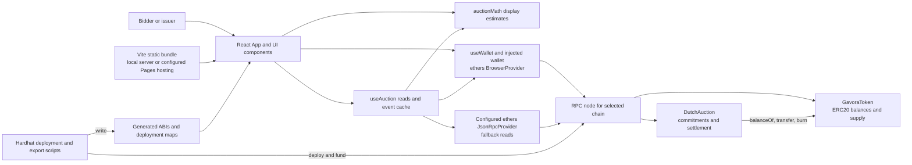
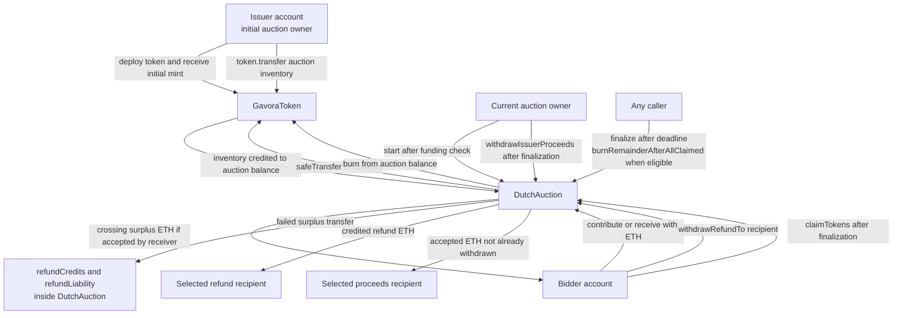
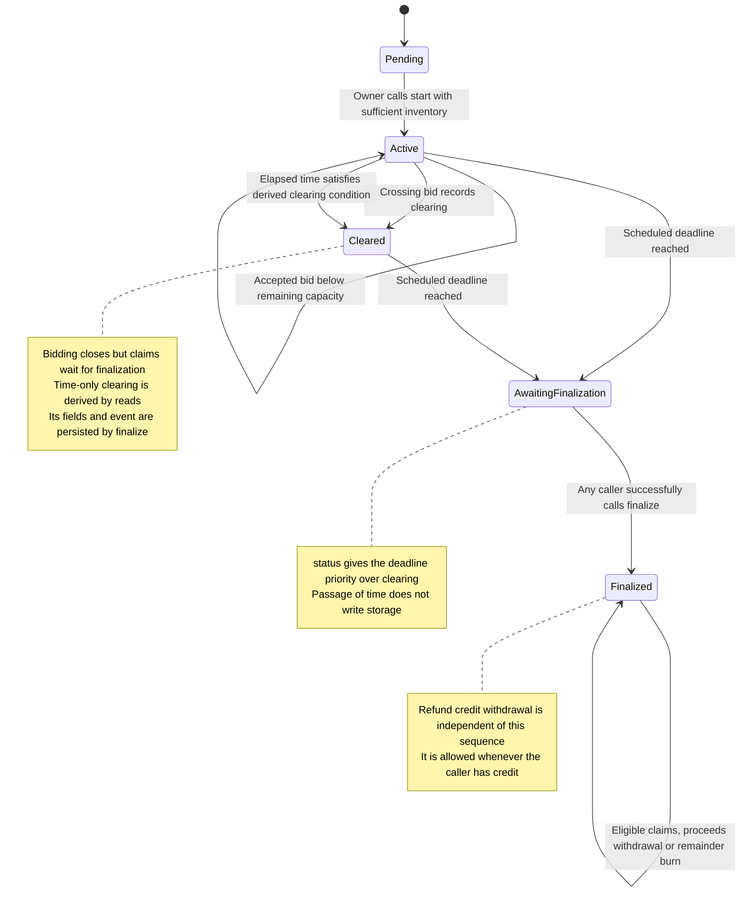
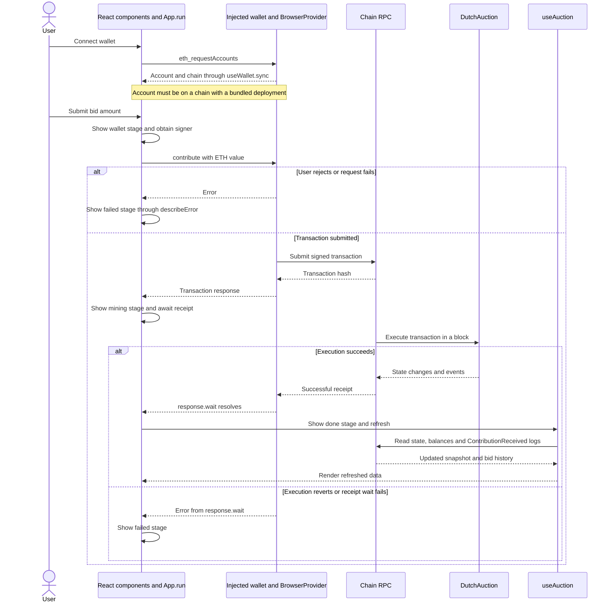

# 4 AI-Generated Architecture

## Architectural baseline and attribution

DutchPoint retains the main structure visible in the first committed FairLaunch implementation. Two Solidity contracts manage token supply and the auction, a React application provides the interface, and Hardhat scripts support deployment and validation. There is no application backend or database in the inspected implementation. Contract state is authoritative, while the browser reads that state, derives display estimates and requests wallet-authorized transactions. This comparison uses the initial commit `0a75a78` and current baseline `c36cb0c`. It describes source behavior rather than an independently executed deployment. [E02, E30, E42–E46]

The term AI-generated refers here to the repository's development attribution. The prompt index and development log credit Codex with the initial implementation, and the later edited Claude Code record describes contract remediation and frontend reconstruction. Corresponding commits corroborate the resulting changes. They do not prove that every architectural decision originated with an agent or identify the author of each line. According to the edited record, our team reviewed proposals and approved selected policy and naming changes. Original sessions and the full division of human responsibilities remain unverified. [E08, E09, E34, E47]

## Overall structure

The runtime application comprises the browser, its wallet or read-only provider, the selected chain's RPC service and the two deployed contracts. Vite produces static assets, and the Pages workflow configures a hosted build for Sepolia. Hosting the frontend does not deploy the contracts. The committed public deployment map is empty, so the repository establishes deployment capability rather than a verified public auction. [E07, E44, E46]

The browser loads generated ABIs and chain-indexed deployment metadata at build time. Hardhat deployment scripts create the token and auction, fund the auction using a token transfer, optionally start it and export metadata for the browser. These scripts are development and deployment infrastructure, not a continuously running service. Test mocks, including the deliberately vulnerable auction, are separate from the production deployment path. [E14, E28, E46]

Figure 4.1 shows the implemented components and supported connections. The wallet route supplies reads when a connected wallet has a deployment on its chain. Otherwise, the application can use the configured read-only provider. The two provider routes are alternatives selected by the application. [E44–E46]

## Contracts, interfaces and authority

`GavoraToken` extends OpenZeppelin ERC20 and ERC20Burnable. Its constructor mints the initial supply to a recipient and fixes the name and symbol as Gavora and GVRA. It defines no later mint function and has no ownership role. Its inherited interface includes `transfer`, `transferFrom`, `approve`, `allowance`, `balanceOf`, `totalSupply`, metadata getters, `burn` and `burnFrom`. Token balances and allowances belong to the inherited ERC20 implementation. Burning reduces supply, so fixed initial supply does not mean an unchanging total supply. [E05, E42]

`DutchAuction` holds the inventory and accepted ETH, tracks commitments, derives clearing, records final settlement and distributes assets. It stores the token through `IERC20`, uses `SafeERC20` for claims and calls `burn` through the locally declared `IBurnableERC20` interface. The supplied deployment pairs it with GavoraToken. The auction's fixed `TOKEN_SCALE` assumes 18-decimal units, and its constructor does not validate arbitrary tokens for those decimal or burn semantics. Compatibility with another token is therefore not established merely by accepting its address. [E42, E46]

The current auction interface separates responsibilities as follows. Solidity-generated getters for public state supplement the explicitly defined view functions. [E42]

| Interface group | Externally callable operations | Permission and state requirements |
| --- | --- | --- |
| Start | `start()` | Current owner only, once, with at least the sale inventory deposited |
| Bid | `contribute()` and payable `receive()` | Caller sends positive ETH while started, before the deadline and before clearing |
| Settlement | `finalize()` | Any caller after the scheduled deadline, once |
| Claim | `claimTokens()` | A contributing address claims its own entitlement once after finalization |
| Refund | `withdrawRefundTo(address)` | Caller withdraws its own existing credit to a nonzero recipient, independently of finalization |
| Revenue | `withdrawIssuerProceeds(address)` | Current owner sends unwithdrawn accepted ETH to a nonzero recipient after finalization |
| Residual inventory | `burnRemainderAfterAllClaimed()` | Any caller after finalization and all participant claims, provided a balance remains |
| Economic views | `status`, `endTime`, `currentPrice`, `clearingState`, `priceAt`, `maxCommitmentAt`, `remainingCapacity`, `tokensOwed` | Read-only access, with estimates or final values as defined by each function |
| Ownership | `owner`, `transferOwnership`, `renounceOwnership` | Inherited Ownable interface, with ownership changes restricted to the current owner |

The owner role governs starting and withdrawing proceeds, not participant eligibility or the finalization caller. The current contract has no separate immutable issuer address. Ownership transfer changes who can exercise those privileges. Renouncing ownership removes the owner able to invoke them, which is an architectural consequence rather than a claim that renunciation occurred. No pause, cancellation, parameter-update, allowlist or upgrade mechanism appears in the production contracts. [E42, E43]

The auction applies `nonReentrant` to bidding, claims, refund and proceeds withdrawals, finalization and remainder burning. `start()` and inherited ownership functions are not covered by that modifier. The earlier documentation's broader claim that every state-changing entry point is guarded should not be repeated. Accounting updates precede outbound ETH or claim-token transfers on the inspected paths. These controls are confirmed in source, but are not a substitute for later vulnerability analysis. [E04, E22, E42]

Figure 4.2 distinguishes ETH flows from token-contract calls. Auction inventory is a balance recorded by the token contract. The auction burns its own holdings and transfers claimed tokens to bidders. No bidder ERC20 approval is required to contribute ETH. The recipient of proceeds or a credited refund can differ from the caller, although the current UI uses the connected account for those withdrawals. [E42, E44]

## State and storage model

The auction stores aggregate accounting and address-indexed mappings, rather than an array that settlement must traverse. Repeated bids increase the same address's commitment. `participantCount` increases on that address's first positive accepted commitment. The following groups describe logical state, not compiler storage-slot layout. Constants and immutables are distinguished from mutable storage. [E42]

| State group | Variables and structures | Architectural role |
| --- | --- | --- |
| Fixed configuration | Constants `AUCTION_DURATION`, `TOKEN_SCALE`. Immutables `token`, `saleSupply`, `startPrice`, `reservePrice` | Fix the time window, units, token and sale parameters |
| Lifecycle | `started`, `finalized`, `cleared`, `startTime`, `lastCommitmentTimestamp`, `clearingTime`, `clearingPrice`, `finalPrice` | Track the start, persisted clearing information and final outcome |
| Accepted commitments | `totalCommitted`, `commitments[address]`, `participantCount` | Record accepted ETH and the number of participating addresses |
| Token accounting | `totalTokensSold`, `totalTokensClaimed`, `burnedUnsold`, `tokensClaimed[address]` | Distinguish final allocation, distributed tokens and burned inventory |
| Claim completion | `claimed[address]`, `claimedParticipantCount` | Prevent duplicate claims and determine eligibility for remainder burning |
| ETH accounting | `refundCredits[address]`, `refundLiability`, `issuerProceedsWithdrawn` | Separate failed surplus payments from sale revenue already withdrawn |
| Inherited state | Ownable ownership and ReentrancyGuard state | Support privileged operations and guarded entry points |

For a crossing bid, only remaining capacity becomes a commitment. The auction first attempts to return the surplus to the bidder. If that transfer fails, it creates a refund credit and increases the aggregate liability. After finalization, token claims use the accepted commitment divided by the final price with integer rounding. Proceeds use `totalCommitted - issuerProceedsWithdrawn`, independently of whether bidders have claimed. The remainder-burning operation consumes the auction's actual remaining token balance after all claims, so its scope includes any donated tokens, not only mathematical rounding dust. [E04, E42]

Claims have no expiry. An unclaimed entitlement can therefore delay the final remainder burn indefinitely, while the owner can still withdraw accepted proceeds after finalization. This follows from the separate counters and accounting paths. It is not evidence of an observed operational failure. [E42]

## Events and lifecycle

The auction emits `AuctionStarted`, `ContributionReceived`, `AuctionCleared` and `AuctionFinalized` for the sale lifecycle. Asset-related events are `SurplusRefunded`, `RefundCredited`, `RefundWithdrawn`, `TokensClaimed`, `IssuerProceedsWithdrawn` and `TokensBurned`. Inherited token and ownership interfaces also expose transfer, approval and ownership events. The current contribution event includes both the amount sent and the amount accepted, allowing event consumers to distinguish them. [E42, E43]

`status()` computes a five-state view. It checks finalization first, then whether the auction started, then the deadline, and finally clearing. A crossing bid records clearing immediately. Time-based clearing can instead be derived by `clearingState()` without a transaction writing those fields. In that case `finalize()` persists the clearing time and price and emits the clearing event. The stored `cleared` boolean is set during finalization, so it is not a complete live indicator of whether bidding has closed. [E42]

Figure 4.3 represents the status view, including transitions caused by elapsed time. It does not imply that a timer runs on-chain or that passing time writes storage. Clearing closes bids early but does not permit early finalization. Refund credits can be withdrawn whenever they exist and are not restricted to the diagram's final state. [E42]

## Frontend and wallet data flow

The initial `src/App.tsx` combined wallet connection, snapshots, transaction handling, clock updates and rendering. It loaded local deployment addresses and required the connected provider for snapshots. The current `frontend/src/App.tsx` coordinates smaller components and hooks. This is a source-confirmed structural change, rather than an inference from coding style. [E43, E44]

| Current module or component group | Responsibility |
| --- | --- |
| `App` | Select provider and deployment, coordinate transaction stages and pass state/actions to components |
| `useWallet` | Restore or request account access, track account and chain changes, switch networks and request token display in the wallet |
| `useAuction` | Read contract/account data, cache event timestamps, scan bid history and serialize refreshes |
| `useNow`, `auctionMath` | Extrapolate time between reads and derive BigInt price, capacity, clearing and quote displays |
| `BidPanel`, `PositionPanel`, `SettlementPanel` | Present bid, claim, refund, owner and public settlement actions |
| `PriceChart`, `DemandMeter`, `BidHistory` | Display price, committed demand and event-derived activity |
| `Header`, `SaleInfo`, `HowItWorks`, `Faq`, `NotDeployed` | Present connection state, metadata, explanations and absent-deployment guidance |
| `useTheme` | Store display preference locally and apply the selected theme |
| `DevTools` | Send local Hardhat time-advance and mining RPC calls when shown for chain 31337 |

These responsibilities are confirmed by the current imports, callbacks and hook implementations. Local demo controls call the node directly and are not production-chain transactions. The project uses custom CSS and SVG chart rendering rather than a separate UI or chart framework. [E44]

`useAuction` builds contract objects with the selected read provider. It requests auction configuration, accounting, account position, token balances and the latest block. It refreshes on block events with a 15-second fallback. Bid history is reconstructed from `ContributionReceived` logs in 10,000-block chunks, with progress and timestamps held in browser memory. There is no separate indexer service. The reads are concurrent individual calls rather than one atomic snapshot pinned to a block. The stale-read and reorganisation questions already recorded in E20 remain unresolved. [E20, E44]

`App` extrapolates chain time from the latest fetched timestamp and elapsed browser time, then calls `viewAt` for display. This improves visual continuity but does not authorize transactions or replace contract checks. UI estimates can change before a transaction is mined. Likewise, displaying owner-only controls is a convenience, while the contract's `onlyOwner` checks enforce authority. [E42, E44]

Wallet connectivity uses the injected `window.ethereum` interface and ethers `BrowserProvider`. The hook requests accounts, reads the chain ID and reconstructs the provider when account or chain changes. It supports switching networks, adding the local chain if missing, and `wallet_watchAsset` for token display. It does not implement WalletConnect or collect signing keys. Adding a token to wallet display is distinct from transferring tokens or approving an allowance. [E06, E45]

Figure 4.4 follows a bid through `App.run`. Other auction actions use the same transaction wrapper. The wallet authorizes submission, the chain executes the call, and the application waits for a receipt before requesting refreshed data. Rejected requests and failed receipt waits produce a failed UI stage. [E45]

## Evolution and supporting dependencies

The architectural changes can be reconstructed without treating revised documentation as the original design. [E43, E47]

| Area | Initial implementation | Current implementation and recorded reason |
| --- | --- | --- |
| Token | `LaunchToken` with constructor metadata, `maxSupply` and Ownable | `1ba8883` introduces GavoraToken and removes the unused ownership role during rebranding |
| Allocation and refunds | Full contributions, pro-rata allocation for a cleared sale and refunds calculated during account settlement | `20e24b1` caps crossing bids and separates surplus refunds, addressing the documented crowd-out scenario |
| Settlement accounting | `_settleAccount` combines token transfer, refund creation and proceeds accrual | `20e24b1` separates token claims and credits, making accepted proceeds available after finalization without waiting for each bidder |
| Lifecycle interface | Stored clearing drives read behavior, with deadline ordering problems | `20e24b1` introduces derived clearing views and corrects status ordering in response to regressions |
| Browser structure | Combined App with local-address metadata | `c689e3c` introduces components, hooks and display mathematics aligned with the revised auction |
| Delivery | Local deployment and browser setup | `4c991e6`, `4d88495`, `388399e` and `9d828ae` add optional Sepolia tooling, deployment/offline states, chunked event reads and static Pages delivery |
| Interface feedback | Earlier dashboard controls | `9fef77c` and `c36cb0c` add wallet/theme and explanatory UI features after the recorded feedback and design discussion |

The initial auction's `issuer` immutable was removed, while current-owner access remains. The old settlement mappings and `issuerProceedsAvailable` were replaced by simpler claim and credit accounting. Interfaces changed accordingly, including replacement of `settlementOf` with the current views and replacement of `burnRemainderAfterAllSettled` with `burnRemainderAfterAllClaimed`. These are contract and ABI changes between source versions, not an on-chain upgrade process. No proxy or migration mechanism is present. [E43]

The root package manifest supplies the frontend and tooling dependencies. It declares ethers 6.17.0, React and react-dom 19.3.0, Hardhat 3.18.0, the Mocha/ethers toolbox 4.0.0, OpenZeppelin Contracts 5.6.1, TypeScript 7.0.2 and Vite 8.3.5. These are repository-declared versions, not fresh installation results. Solidity is pinned to 0.8.28. The default compiler profile uses 200 optimizer runs, while a separate production profile uses 500 runs and viaIR. Deployment scripts do not explicitly select that production profile. [E46]

OpenZeppelin supplies reusable token, ownership, transfer and arithmetic primitives. ethers connects browser and deployment code to contracts. React and Vite provide the client and build process. Hardhat runs TypeScript tests and Solidity properties that import forge-std, while Slither and GitHub Actions support analysis and automation. These tools are infrastructure rather than additional runtime business components. Generated ABI exports are produced mechanically by scripts and do not independently demonstrate AI authorship. [E11, E16, E28, E46]

The separation of responsibilities and smaller frontend modules plausibly improve reviewability, but that benefit is inferred rather than measured. The confirmed findings are the interfaces, dependencies and source changes described above. Live deployment, complete prompt provenance, arbitrary-token compatibility and correctness outside the tested scenarios remain unverified. Those limits carry forward to later stages without issuing a vulnerability verdict here.

The four Mermaid sources are retained in `../diagrams/`. Their code locators and interpretation boundaries are recorded in E42–E48 of `../audit_evidence.md`.
